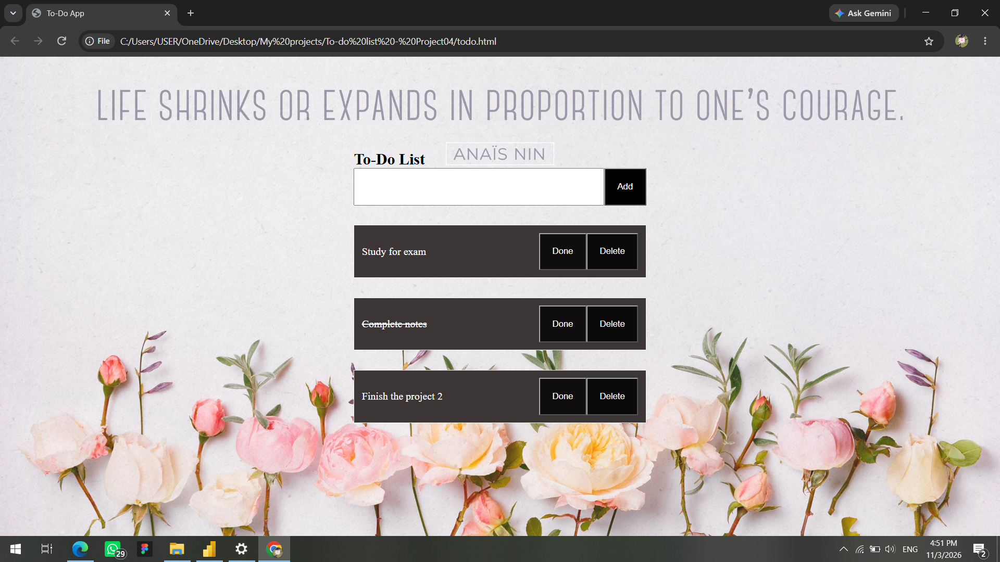

# To-Do List App

A simple To-Do List web application that helps users keep track of daily tasks.

## Features
- Add new tasks
- Mark tasks as completed
- Delete tasks
- Simple and easy-to-use interface

## Technologies Used
- HTML
- CSS
- JavaScript

## How to Run
1. Download or clone this project.
2. Open the project folder.
3. Open `todo.html` in a web browser.
4. Enter a task and click **Add**.
5. Click **Done** to mark a task as completed, or **Delete** to remove it.

## Screenshot


## Project Structure
```text
Project/
├── todo.html
├── todo.css
├── todo.js
└── docs/
    └── Screenshot.png
```

## Purpose
This project was created for practice with basic front-end web development and JavaScript DOM manipulation.
